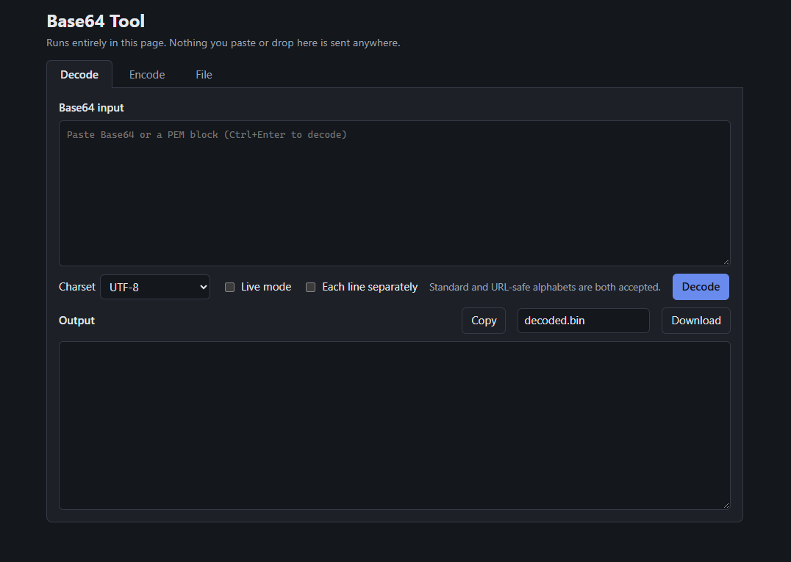

# Base64 Tool

An offline, single-file Base64 encoder/decoder modelled on base64decode.org.
Open `dist/base64-tool.html` by double-clicking it. Nothing you paste or drop is sent anywhere:
the page has no external resources, and its Content-Security-Policy (`default-src 'none'`)
blocks all network requests. Text boxes have autocomplete turned off, so the browser does not
save their contents in its form or session-restore data.



## Features

- **Decode:** Base64 → text in any common charset (UTF-8, UTF-16LE/BE, Windows-125x, ISO-8859-x, Shift_JIS, GBK, …).
  - Lenient: accepts whitespace, missing padding, and both the standard and URL-safe alphabets.
    No-break spaces, zero-width spaces and stray byte-order marks from copied text are ignored too.
  - Errors show the exact character and its position. Invisible or non-ASCII characters also show their
    code point, e.g. `Invalid character 'é' (U+00E9) at position 4`, so an invisible character is not just a blank.
  - PEM armor (`-----BEGIN …-----`) is detected and stripped automatically:
    - text before and after the block (e.g. `openssl` "Bag Attributes") is ignored;
    - older RFC 1421 headers (`Proc-Type:`, `DEK-Info:`) are skipped, with a warning when the key is encrypted;
    - if the input holds several PEM blocks, only the first is decoded and a note says how many were found;
    - a BEGIN line without its matching END line (truncated paste, mismatched labels) is an error, not garbage.
  - A `data:<type>;base64,` URI prefix is stripped, and the note names the media type.
  - A space inside a line (for example an `Authorization: Basic …` or `Bearer …` prefix) gives a warning,
    because everything on the line is decoded together.
  - Binary output is shown as a hex dump and can be downloaded as raw bytes.
- **Encode:** text → Base64 as UTF-8, UTF-16LE/BE or ISO-8859-1, with options for URL-safe, 76-char MIME lines and PEM wrapping.
- **Both modes:**
  - Live mode. It turns itself off for input over 10 MB; use the button instead.
  - *Each line separately*. Blank lines and PEM armor lines stay as empty lines, so output lines line up with input lines.
  - Output over 5 MB is not shown in the box; a note says so, and Copy/Download still use the full result.
  - Copy shows "Copying…" while it works and "Copy failed" if the browser refuses.
- **File:** encode any file to Base64/PEM, or decode a Base64/PEM file back to its original bytes.
  - Base64 files saved as UTF-16 or with a byte-order mark (e.g. by Windows PowerShell 5.1 `>` / `Out-File`) are read correctly.
  - Convert is disabled while a file is being read. If you pick another file or switch mode meanwhile, the old result is discarded.
  - Dropping a file outside the drop zone does nothing, so you can't lose your work by navigating away.

Tip: PowerShell `-EncodedCommand` payloads are UTF-16LE. Pick that charset when decoding them.

Note: on machines with endpoint protection that inspects files or the clipboard,
picking a file or copying a large result can take several seconds. That is the scan, not the tool.

## Development

Requires Node 18+ (developed on Node 24). No npm install; there are no dependencies.

```bash
node --test        # unit tests (core logic + build checks)
node build.mjs     # writes dist/base64-tool.html
```

Source layout:

| Path | Role |
|---|---|
| `src/core.js` | Pure encode/decode logic (browser global `B64`, Node module) |
| `src/ui.js` | DOM wiring |
| `src/index.html`, `src/style.css` | Page template and styles |
| `build.mjs` | Inlines CSS/JS into the template to produce the single HTML file |

Rebuild and commit `dist/base64-tool.html` after changing anything in `src/`.

## License

MIT. See [LICENSE](LICENSE).
